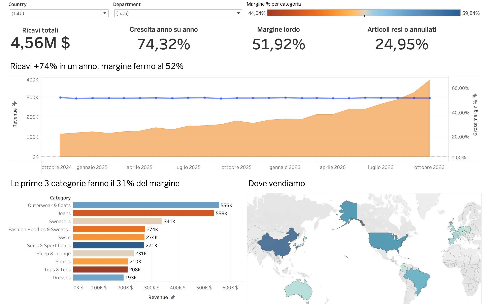
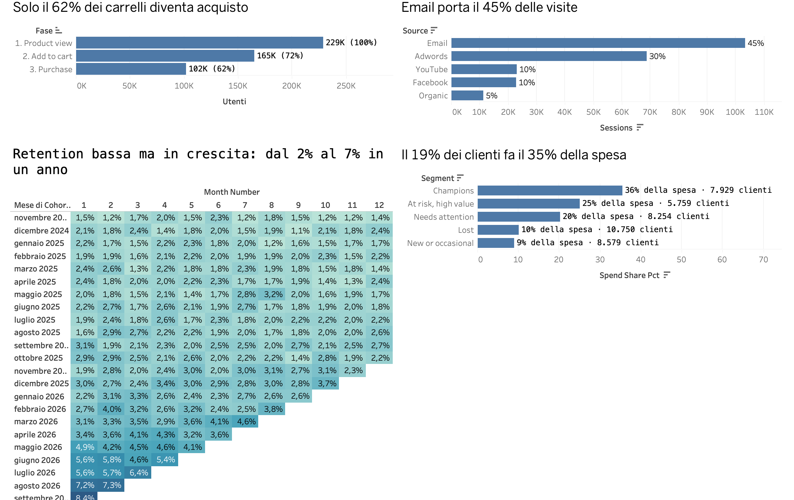

# E-commerce Performance – TheLook (BigQuery · SQL · Tableau)

Analysis of 24 months of orders and website events from an online clothing store, from raw data in BigQuery to a two-page Tableau dashboard.

**👉 Interactive dashboard: [TheLook E-commerce Performance on Tableau Public](https://public.tableau.com/app/profile/andrea.tricerri/viz/TheLookE-commercePerformance)**



## Business questions

1. How are orders, revenue and margin trending?
2. Which product categories make the most money?
3. Where do we lose sales (returns and cancellations)?
4. Where do website visitors drop off, and which channel converts best?
5. Do customers come back after their first purchase?
6. Which customers are worth the most?
7. Which acquisition channels bring the best customers in each country?
8. Is logistics a bottleneck?

## Key findings

| # | Finding | So what |
|---|---|---|
| 1 | Revenue **4.56M $**, **+74%** in the second year; gross margin flat at **52%**; average order value stable at about 85 $ | Growth comes from more orders, not bigger baskets |
| 2 | Outerwear & Coats and Jeans each bring ~12% of revenue; the top 3 categories make **31% of margin**; Jeans has a below-average margin (46.5%) | Jeans drives volume but earns less: the first category to review on pricing |
| 3 | About **1 item in 4** never becomes revenue (≈10% returned, ≈15% cancelled), almost the same in every category | The issue is in the process, not in specific products |
| 4 | 72% of product viewers add to cart, but only **62% of carts become purchases**; Email brings **45%** of sessions | Checkout is the weak point of the funnel |
| 5 | Month-1 repurchase grew from **~2%** (late-2024 cohorts) to **~8%** (2026 cohorts) | Retention is still low but improving: the biggest growth lever |
| 6 | **Champions** (19% of customers) generate **36% of spend**; "At risk, high value" customers hold another **25%** | A reactivation campaign on the at-risk segment targets a quarter of spend |
| 7 | Average spend per customer varies little between channels (100–140 $) | Channel budget should be decided on acquisition cost, not customer value |
| 8 | All 10 distribution centres ship in about half a day and deliver in ~2.5 days; 90% arrive within 6 days | Logistics is not the bottleneck, so it was left out of the dashboard |



## Dashboard

**Page 1 – Sales and margin:** 4 KPIs, monthly revenue and margin trend, top 10 categories coloured by margin, revenue map by country. Filters for country and department.

**Page 2 – Customers and funnel:** purchase funnel, sessions by channel, cohort retention heatmap, RFM segments.

## SQL techniques used

| Technique | Where |
|---|---|
| CTEs | all multi-step queries |
| Window functions: `LAG`, `FIRST_VALUE`, `NTILE`, `RANK`, `SUM(SUM()) OVER ()` | Q1, Q2, Q5, Q6, Q7 |
| `GROUP BY ROLLUP` for subtotals | Q4 |
| `LOGICAL_OR` to flatten events into one row per session | Q4 |
| `COUNTIF`, `HAVING`, `SAFE_DIVIDE` | Q1–Q4, Q7 |
| `DATE_TRUNC`, `DATE_DIFF`, `TIMESTAMP_DIFF` | Q1, Q5, Q8 |
| `APPROX_QUANTILES` for the 90th percentile | Q8 |

## Repository structure

```
sql/
  01_data_checks.sql      row counts and date range of each table
  02_analysis.sql         the 8 business questions
  03_tableau_export.sql   aggregated tables exported to CSV for Tableau
images/
  dashboard_page1.png
  dashboard_page2.png
```

## How to reproduce

1. Open [BigQuery](https://console.cloud.google.com/bigquery) with a Google account (the free sandbox is enough, no credit card needed).
2. Add the public dataset `bigquery-public-data.thelook_ecommerce`.
3. Run the files in `sql/` in order, one query at a time.
4. Save the export queries as CSV and connect them in Tableau Public.

## Data notes and limitations

- **Synthetic data.** TheLook is generated by Google, so some metrics are unusually uniform (return rates and conversion are almost identical across categories). Results describe the dataset, not a real business.
- **Fixed time window.** Google regenerates the dataset over time, so every query uses November 2024 – October 2026 to keep the numbers in this README reproducible.
- **Data quality issue found.** Germany appears both as `Germany` and `Deutschland` in the `country` field, so it shows up twice in the dashboard's country filter. Next step: normalise it in the export query with `CASE WHEN country = 'Deutschland' THEN 'Germany' ELSE country END`.
- **Bug found and fixed.** In the funnel query, an alias named `traffic_source` shadowed the column of the same name in `GROUP BY`, so the `ROLLUP` total row came out empty. Renaming the alias to `source` fixed it.
- **All numbers in this README** come from the queries in `sql/`, run on 16 November 2026.

## Data source

[TheLook eCommerce – BigQuery public dataset (Google Cloud Marketplace)](https://console.cloud.google.com/marketplace/product/bigquery-public-data/thelook-ecommerce)

---

**Author:** Andrea Tricerri · Data / BI Analyst
